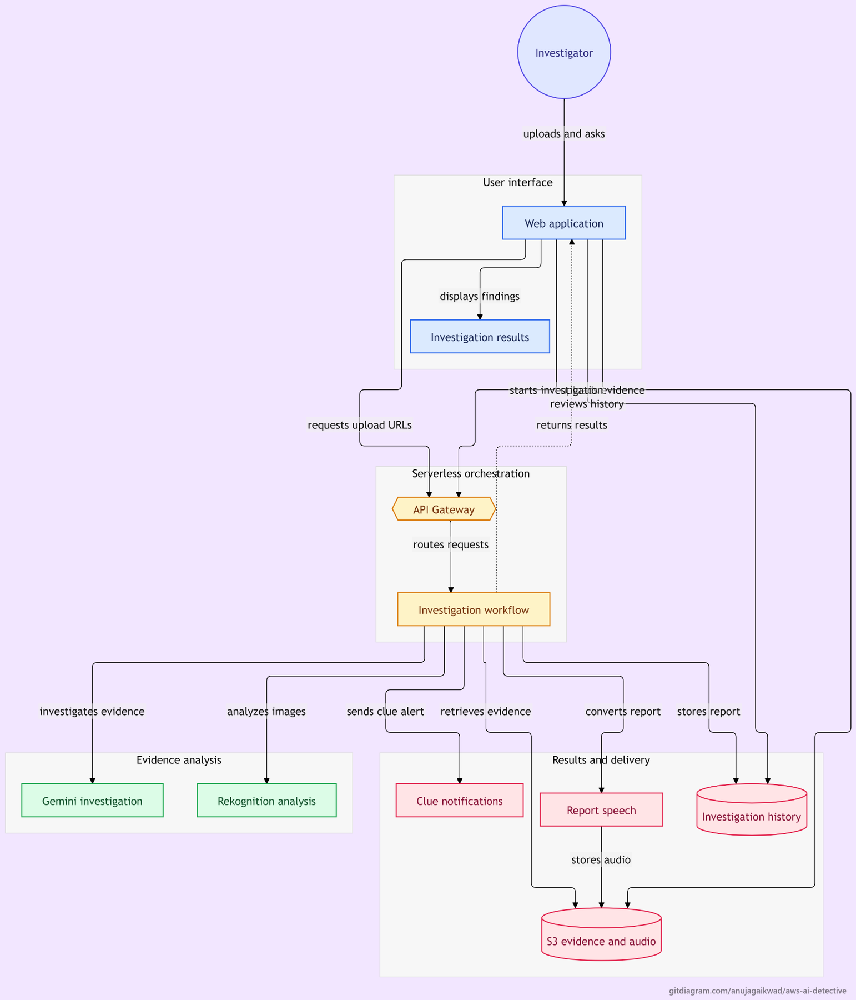
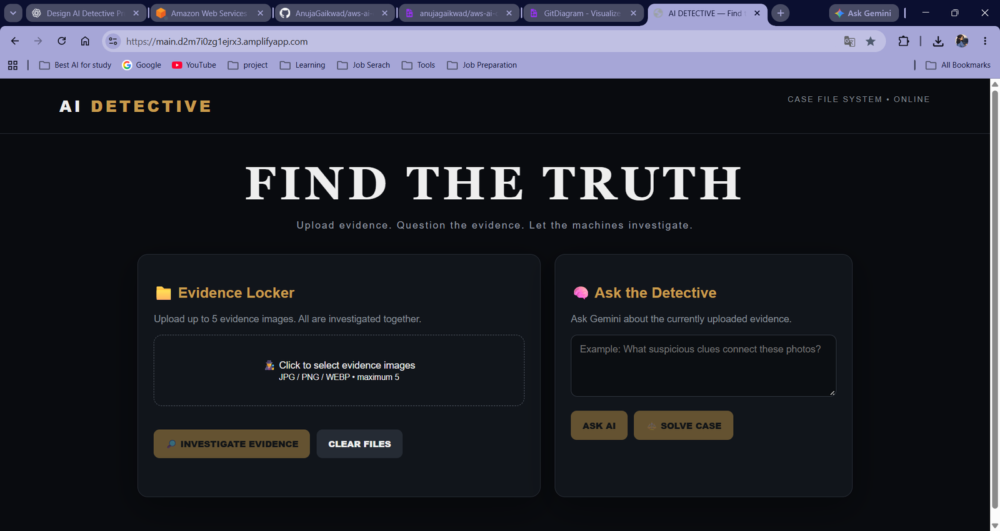
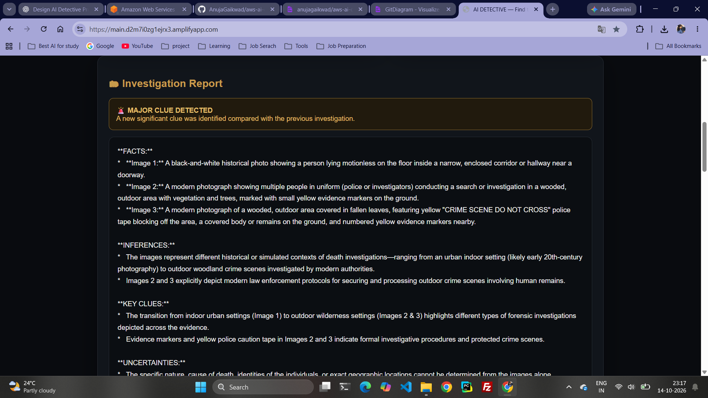
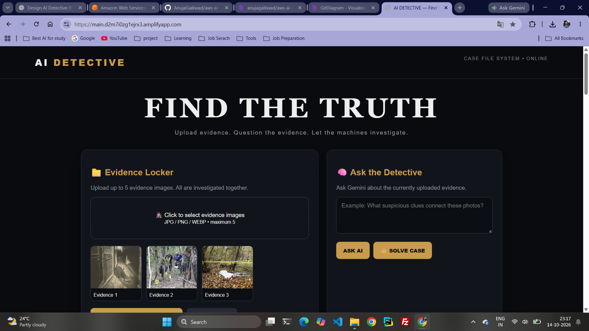
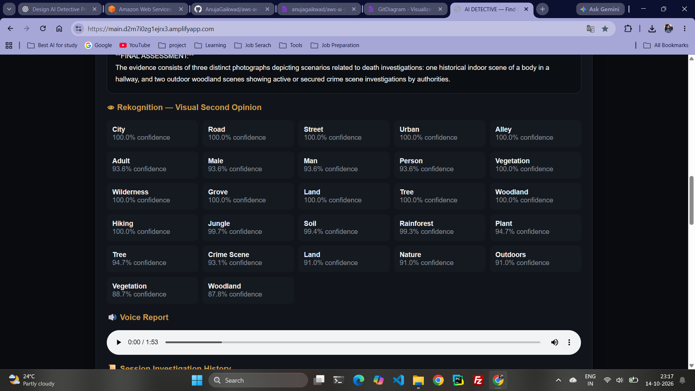
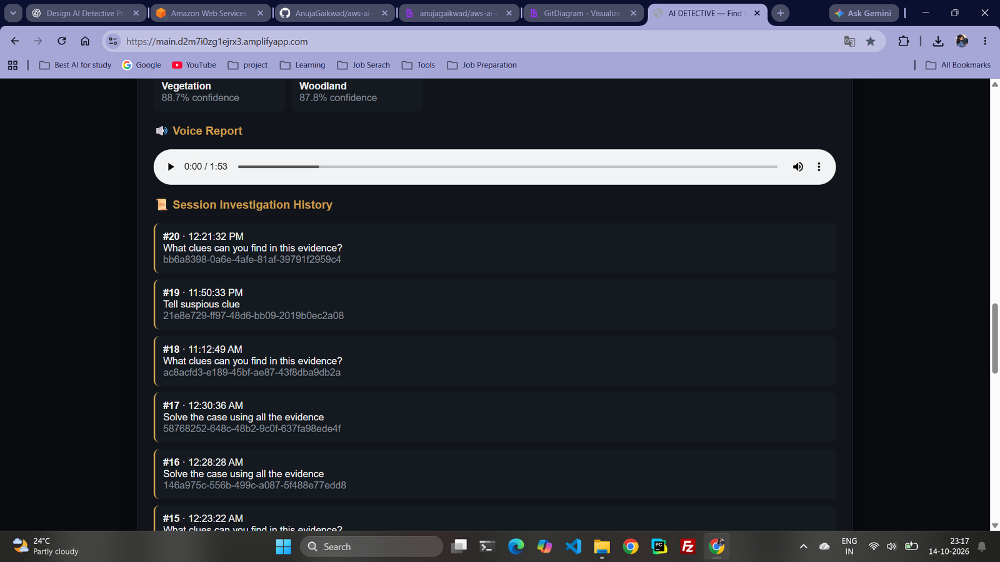
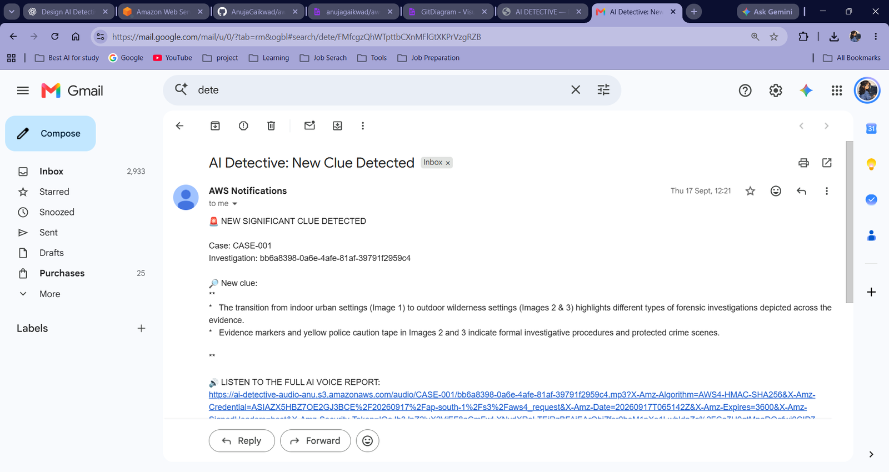

# 🕵️ AI Detective

### AI-Powered Evidence Investigation System

AI Detective is a serverless evidence investigation application that combines Google Gemini with AWS AI services to analyze multiple images, identify visual clues, generate investigation reports, and provide an audio version of the results.

**Live Demo:** https://main.d2m7i0zg1ejrx3.amplifyapp.com/

**GitHub Repository:** https://github.com/AnujaGaikwad/aws-ai-detective

## 🎯 Objective

The goal of AI Detective is to demonstrate how multimodal AI and AWS serverless services can work together to investigate visual evidence and present structured findings.

Users can:

- Upload up to five evidence images
- Ask questions about the evidence
- Analyze multiple images together
- Generate structured investigation reports
- View visual analysis with confidence scores
- Generate an audio investigation report
- Review previous investigation history
- Receive email alerts when new significant clues are detected

## 🏗️ System Architecture

AI Detective uses a serverless architecture to connect the web application with AI analysis, storage, reporting, and notification services.



### Architecture overview

1. The investigator interacts with the web application hosted on AWS Amplify.
2. The frontend requests presigned upload URLs through Amazon API Gateway.
3. Evidence images are uploaded to Amazon S3.
4. The frontend starts an investigation through API Gateway.
5. AWS Lambda coordinates the asynchronous investigation workflow.
6. Amazon Rekognition analyzes the evidence images.
7. Google Gemini analyzes the images and Rekognition results.
8. Amazon DynamoDB stores investigation records and history.
9. Amazon Polly generates an audio report, which is stored in S3.
10. Amazon SNS sends an email alert when new significant clues are detected. The alert includes a temporary link to the voice report.
11. The frontend displays the report, visual analysis, audio report, and investigation history.

## ☁️ AWS Services Used

| Service | Purpose |
|---|---|
| AWS Amplify | Hosts the web application |
| Amazon API Gateway | Routes frontend API requests |
| AWS Lambda | Runs the investigation workflow |
| Amazon S3 | Stores evidence images and generated audio |
| Amazon DynamoDB | Stores investigation records and history |
| Amazon Rekognition | Performs visual analysis |
| Amazon Polly | Converts investigation reports to speech |
| Amazon SNS | Sends significant-clue email notifications |
| AWS IAM | Manages service permissions |
| Amazon CloudWatch | Provides execution logs for troubleshooting |

## 🤖 AI Technology

### Google Gemini

Gemini provides multimodal reasoning across the uploaded evidence. It can:

- Analyze multiple evidence images together
- Answer questions about the evidence
- Identify potential key clues
- Generate structured investigation reports
- Separate facts, inferences, key clues, and uncertainties

The system is instructed to avoid inventing unsupported facts.

### Amazon Rekognition

Rekognition provides a visual second opinion by detecting objects, scenes, and other visual information with confidence scores. These labels support the investigation but do not independently prove a conclusion.

## 🔄 Investigation Workflow

1. The user selects up to five JPG, PNG, or WEBP evidence images.
2. The frontend requests presigned upload URLs.
3. Evidence images are uploaded to S3.
4. The user starts an investigation.
5. Lambda records the investigation status in DynamoDB and invokes the worker asynchronously.
6. Lambda retrieves the images from S3.
7. Rekognition analyzes the images and returns visual labels.
8. Gemini analyzes the images together with Rekognition results.
9. Polly converts the investigation report into an MP3 audio file.
10. The audio file is stored in S3.
11. Investigation results and history are saved in DynamoDB.
12. If new significant clues are detected, SNS sends an email with a temporary audio link.
13. The frontend displays the investigation report, visual analysis, audio player, and history.

## ✨ Key Features

- Multi-image evidence investigation
- Gemini-powered multimodal reasoning
- Rekognition visual analysis and confidence scores
- Structured investigation reports
- Significant-clue detection
- Email notifications with a voice-report link
- Text-to-speech investigation reports
- Persistent investigation history
- Presigned S3 URLs
- Asynchronous serverless processing
- Responsive detective-themed interface

## 🖥️ Application Screenshots

### 1. Web Application



### 2. Investigation Report and Detected Clue



### 3. Rekognition Analysis and Voice Report



### 4. Persistent Investigation History



### 5. Evidence Upload and Results Interface



### 6. SNS Email Alert with Audio Link



## 📁 Repository Structure

```text
aws-ai-detective/
├── Data/
│   ├── sample-01.jpg
│   ├── sample-02.jpg
│   ├── sample-03.jpg
│   ├── sample-04.jpg
│   ├── sample-05.jpg
│   ├── sample-06.jpg
│   └── test-sample.jpg
├── architecture/
│   └── ai-detective-architecture.png
├── screenshots/
│   ├── 01-web-application-home.png
│   ├── 02-investigation-report.png
│   ├── 03-rekognition-and-voice-report.png
│   ├── 04-session-investigation-history.png
│   ├── 05-evidence-and-results-view.png
│   └── 06-sns-email-with-audio-link.png
├── Flow.png
├── Output.png
├── ai_detective.html
├── index.html
├── .gitignore
└── README.md
```

## 🛠️ Technologies

- HTML, CSS, JavaScript
- Python 3.12
- AWS Amplify
- Amazon API Gateway
- AWS Lambda
- Amazon S3
- Amazon DynamoDB
- Amazon Rekognition
- Amazon Polly
- Amazon SNS
- AWS IAM and CloudWatch
- Google Gemini API and Google Gen AI SDK

## 🔐 Security and Cost Considerations

- Keep the Gemini API key in Lambda environment configuration; never commit it to GitHub.
- Do not commit AWS credentials, `.env` files, private keys, or temporary presigned URLs.
- Keep evidence and audio S3 buckets private.
- Presigned URLs provide temporary access; the voice-report link in the SNS email expires after one hour.
- AWS and Gemini usage may incur charges or be subject to free-tier quotas. Check current pricing before extended use.

## 🚀 Deployment Overview

The frontend is hosted on AWS Amplify. Amazon API Gateway exposes the HTTP API, and AWS Lambda coordinates uploads, asynchronous investigations, status checks, and history requests.

The backend requires appropriately configured S3 buckets, a DynamoDB table, a Lambda execution role, a Gemini API key, an SNS topic, and the required service permissions.

## 🎓 Key Learning Outcomes

Through this project, I practiced:

- Building serverless applications on AWS
- Designing API-driven architectures
- Using presigned S3 URLs
- Implementing asynchronous Lambda workflows
- Integrating Gemini with Amazon Rekognition
- Storing structured results in DynamoDB
- Generating audio reports with Amazon Polly
- Sending email notifications using SNS
- Troubleshooting IAM permissions, API timeouts, CORS, and DynamoDB data types
- Documenting and deploying an end-to-end cloud project

## ⚠️ Disclaimer

AI Detective is an educational demonstration. AI-generated findings may contain errors or unsupported inferences. The output must not be treated as verified evidence or used to make real-world law-enforcement decisions.
