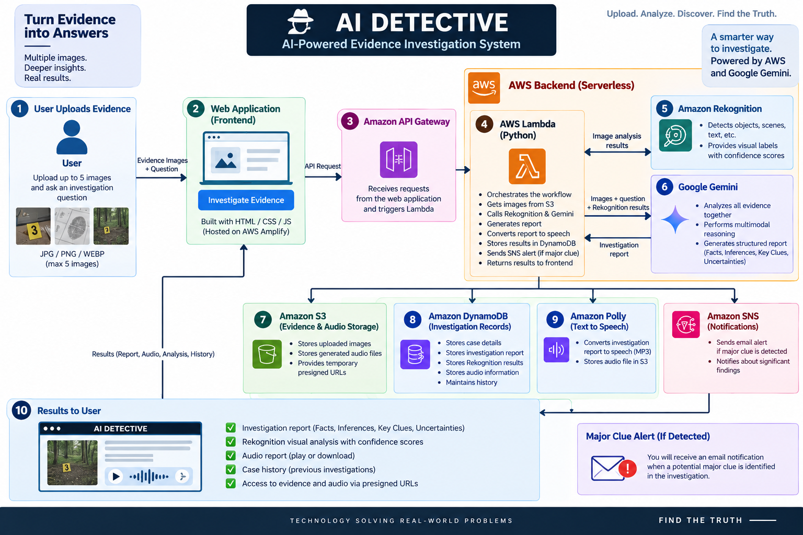
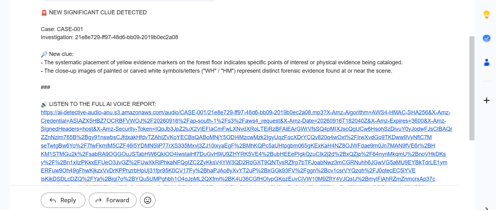

# 🕵️ AI Detective

### AI-Powered Evidence Investigation System

AI Detective is a serverless evidence investigation application that combines Google Gemini with AWS AI and cloud services to analyze multiple images, identify visual clues, generate investigation reports, and provide an audio version of the results.

## 🎯 Objective

The goal of AI Detective is to demonstrate how multimodal AI and AWS serverless services can work together to investigate visual evidence and present structured findings.

Users can:

- Upload up to 5 evidence images
- Ask questions about the evidence
- Analyze multiple images together
- Generate an investigation report
- View visual analysis with confidence scores
- Generate an audio investigation report
- Review previous investigation history
- Receive an email alert when a major clue is detected

## 🏗️ Architecture

The application follows a serverless architecture:

```text
User
  │
  ▼
AWS Amplify
  │
  ▼
Web Application
  │
  ▼
Amazon API Gateway
  │
  ▼
AWS Lambda (Python)
  │
  ├──► Amazon S3
  │      └── Evidence & audio storage
  │
  ├──► Amazon Rekognition
  │      └── Visual analysis
  │
  ├──► Google Gemini
  │      └── Multimodal investigation & report
  │
  ├──► Amazon DynamoDB
  │      └── Investigation records & history
  │
  ├──► Amazon Polly
  │      └── Text-to-speech report
  │
  └──► Amazon SNS
         └── Major clue email notification

  ▼
Investigation Results
```

## ☁️ AWS Services Used

| Service | Purpose |
|---|---|
| AWS Amplify | Hosts the web application |
| Amazon API Gateway | Receives frontend API requests |
| AWS Lambda | Runs the serverless investigation workflow |
| Amazon S3 | Stores evidence images and generated audio |
| Amazon DynamoDB | Stores investigation records and history |
| Amazon Rekognition | Performs visual analysis |
| Amazon Polly | Converts the investigation report to speech |
| Amazon SNS | Sends major-clue email notifications |

## 🤖 AI Technology

### Google Gemini

Gemini is used for multimodal reasoning across the uploaded evidence.

It can:

- Analyze multiple evidence images together
- Answer questions about the evidence
- Identify key clues
- Generate structured investigation reports
- Separate facts, inferences, key clues, and uncertainties

The system is instructed not to invent facts when solving a case.

### Amazon Rekognition

Rekognition provides a visual second opinion by detecting objects, scenes, and other visual information with confidence scores.

## 🔄 Investigation Workflow

1. User uploads evidence images.
2. The frontend requests presigned upload URLs through API Gateway.
3. Evidence images are uploaded to Amazon S3.
4. The frontend starts an investigation through API Gateway.
5. AWS Lambda orchestrates the investigation.
6. Lambda retrieves the evidence from S3.
7. Amazon Rekognition analyzes the images.
8. Google Gemini analyzes the evidence and Rekognition results.
9. The investigation report is stored in DynamoDB.
10. Amazon Polly converts the report into audio.
11. Generated audio is stored in S3.
12. If a major clue is detected, Amazon SNS sends an email alert.
13. The frontend displays the investigation report, visual analysis, audio report, and investigation history.

## ✨ Key Features

- Multi-image evidence investigation
- Gemini-powered multimodal reasoning
- AWS Rekognition visual analysis
- Structured investigation reports
- Major clue detection
- Email notifications
- Text-to-speech investigation reports
- Investigation history
- Presigned S3 URLs
- Serverless AWS architecture
- Responsive web interface

## 🖥️ User Interface

Users can upload multiple evidence images and ask the AI detective questions about the case.

The application displays:

- Investigation report
- Major clue notification
- Rekognition visual analysis
- Confidence scores
- Audio investigation report
- Investigation history

## 📁 Repository Structure

```text
ai-detective/
├── Data/
│   ├── sample-01.jpg
│   ├── sample-02.jpg
│   ├── sample-03.jpg
│   ├── sample-04.jpg
│   ├── sample-05.jpg
│   ├── sample-06.jpg
│   └── test-sample.jpg
├── Flow.png
├── Output.png
├── ai_detective.html
├── index.html
├── .gitignore
└── README.md
```

## 🛠️ Technologies

- HTML
- CSS
- JavaScript
- Python
- AWS Lambda
- Amazon API Gateway
- Amazon S3
- Amazon DynamoDB
- Amazon Rekognition
- Amazon Polly
- Amazon SNS
- AWS Amplify
- Google Gemini

## 📸 Architecture



## 📊 Sample Output



## 🔐 Security

No AWS credentials, private keys, or environment secrets are included in this repository.

The repository uses `.gitignore` rules to prevent accidental commits of files such as `.env`, `.pem`, and `.key` files.

## 🚀 Deployment

The frontend can be hosted using AWS Amplify.

The backend uses API Gateway and AWS Lambda to provide the investigation API and coordinate the serverless workflow.

Required AWS resources include:

- API Gateway API
- Lambda function
- S3 bucket
- DynamoDB table
- Rekognition access
- Polly access
- SNS topic
- Appropriate IAM permissions

A Gemini API credential is required for Gemini-powered investigation.

## 🎓 Key Learning Outcomes

Through this project, I practiced:

- Building serverless applications on AWS
- Designing API-driven architectures
- Working with multimodal AI
- Integrating Google Gemini with AWS
- Image analysis using Amazon Rekognition
- Object storage using Amazon S3
- NoSQL data management using DynamoDB
- Text-to-speech using Amazon Polly
- Event-driven notifications using SNS
- Building asynchronous investigation workflows
- Designing user-focused AI applications

## ⚠️ Disclaimer

AI Detective is a demonstration and educational project.

AI-generated investigation results may contain errors or incorrect inferences and should not be treated as factual evidence or used for real-world law-enforcement decisions.
